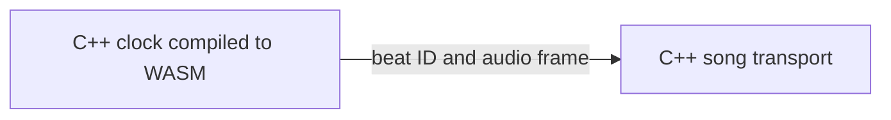
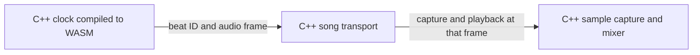
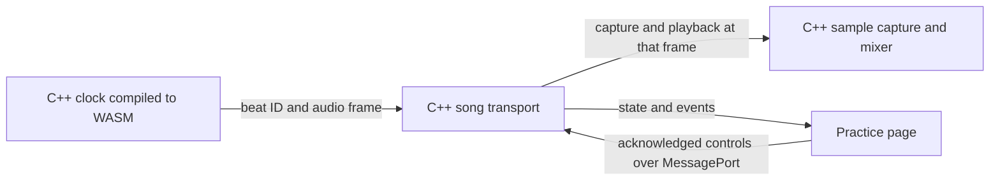

# How the practice instrument fits together

The practice desk is a browser instrument that records your microphone into loops and plays those loops against a song chart. A shared C++ performance engine owns musical time and execution. The browser worklet supplies audio blocks, and the page displays state and submits controls.

This account describes the shared C++ performance engine as of October 27, 2026. The [development guide](development.md) covers starting another session and dividing the next work. The [practice guide](../ui/practice/README.md) covers performing a take.

## Musical time starts with audio frames

A sample frame is one instant in an audio stream. At 48,000 Hz, 48,000 frames represent one second. The C++ clock advances by the number of frames the browser asks it to process. Its beat events carry both a beat ID and a frame timestamp.

The song transport translates those beat IDs into count-in, bar, and beat. A sheet column describes a musical position, but neither Sheets nor the browser's animation timer advances the song.

The default build uses a starting BPM and manual tempo. Microphone input supplies recorded sound. It does not determine tempo in this build. The optional aubio build can follow detected tempo, but the practice UI does not expose that mode.

The C++ performance engine runs inside the audio worklet. Its `pf_process()` call advances the clock and processes the audio block. When a beat falls inside that block, C++ renders up to the crossing, applies the action, then renders the remainder. A queued commit can therefore end a recording and begin its loop at the same boundary.

The worklet receives mono microphone PCM and produces separate stereo sample/click and processed-live buses for browser routing. The UI receives snapshots and events after audio decisions. It can stall without becoming the source of beat timing.

Offline product commands remain separate from this audio path. The [deterministic command contract](implementation/deterministic-pipelines.md) rejects invalid inputs or artifacts with actionable diagnostics. Surrounding harness failures request Chief recovery. Neither path schedules audio or supplies a JavaScript fallback for musical execution.

This is one `AudioWorkletNode`. `PracticeProcessor`, `PerformanceProcessor`, and `BeatProcessor` are classes in its inheritance chain, not separate audio nodes. These classes route browser messages and serialize native state. They do not dispatch musical actions or synthesize clicks in JavaScript.

The main-thread [PracticeAudio adapter](../ui/practice/audio.ts) creates that processor and its local command endpoint. Tracker commands use the node's original port. Practice and sampler commands use a dedicated `MessageChannel`. This local bridge carries controls and observations without a network round trip.

## C++ executes the performance

The [performance engine](../lib/performance/README.md) owns the clock, sampler, and sequencer. Its `pf_process()` entry point advances the clock, finds beat crossings, resolves chart actions, captures input, and renders samples and click audio. The same C++ implementation builds as WASM for browser practice and as a native library.

The [clock C interface](../lib/beat-tracker/include/beat_tracker.h) supplies phase, beat crossings, command ordering, and optional tempo detection. The [sampler C interface](../lib/sampler/include/sample_engine.h) supplies PCM storage, capture, sparse-hit extraction, retained variants, voices, resampling, gain, mute, and mixing. The [sequencer C interface](../lib/sequencer/include/audio_sequence_engine.h) supplies patterns, quantized launches, playback cues, and capture boundaries.

The performance engine adds song count-in, bar and beat, practice ranges, loop wrapping, chart-action resolution, manual-hit loop resumption, automatic variant selection, channel lights, and control deduplication. It also synthesizes the click. `pf_start()` selects manual tempo and applies the supplied BPM itself. A native caller does not need JavaScript to make those decisions or start the clock.

All components link into the same WASM module. The browser's `manual-clock.wasm` filename is retained, but the file now contains the complete performance engine. PCM and musical state stay in its heap.

The TypeScript bridges have narrower jobs:

- [wasm-performance.ts](../lib/performance/wasm-performance.ts) converts a declarative song into native instruction tables, transfers audio blocks, and formats native state and events.
- [wasm-sequencer.ts](../lib/sequencer/wasm-sequencer.ts) maps pattern names and labels to native IDs and reads sequencer state.
- [wasm-sampler.ts](../lib/sampler/wasm-sampler.ts) maps sample and variant names to native IDs and exposes native sample commands and metadata.

The practice worklet calls `pf_process_stems()` for each block. That entry point uses the same C++ clock and musical execution as `pf_process()` while exposing a distinct processed-live stereo stem. It does not call a JavaScript beat handler to decide which sound plays. The old JavaScript sequencer and TypeScript transport implementations are removed. An old WASM artifact without the performance API fails startup instead of falling back to JavaScript scheduling. `pf_abi_version()` checks the binary against the generated interface constants.

The combined browser module has a fixed 256 MiB heap and cannot grow it during audio processing. Song configuration, pattern definition, capture preparation, and file loading are command-time operations that may allocate. Native block processing, beat dispatch, capture, rendering, triggering, and commit do not allocate or reclaim sample or pattern memory. Active voices keep their old buffer when a replacement take commits. Active and queued patterns likewise retain their copied definition when that pattern ID is redefined.

Native diagnostic queries can expose borrowed PCM views in the WASM heap. These views do not transfer ownership to JavaScript. A later preparation, load, or engine disposal can invalidate them, so they are unsuitable for persistent UI storage.

## A chart supplies actions, and a press performs them

Each song is a loadable module under [songs](../songs/README.md), beside its canonical MusicXML document. `SongScript` supplies a parsed chart, a `Program`, and a practice range. The registry loads the selected module on demand.

The practice desk imports complete MusicXML songs, inspects derived instructions and loads executable artifacts while stopped. Sheets JSON and mapping are ingestion inputs only. `compileSheetsSong` interprets that boundary and `importSheetMusicXml` immediately writes and rereads the canonical document. No downstream consumer recompiles archived source JSON. The [cutover guide](implementation/musicxml-cutover.md) defines the profile, commands and verification.

`lib/performance/musicxml-song.ts` reads and writes the `show-tools-song-v3` MusicXML 4.0 profile. Standard elements own title, parts, meter, reference tempo, sections, arrangement words and onset positions. Versioned application metadata owns capture, retained takes, selection windows and controls. A semantic digest covers the interpreted document and song voice metadata, excluding optional import archives and UI selection. Unsupported notation or contradictory displayed commands fail visibly. `musicxml-model.ts` defines the shared parsed report. `musicxml-source-view.ts` projects a bounded sheet-shaped view for catalog discovery and following from that report and typed actions, without consulting the archive.

The [bound Sheets exporter](implementation/sheets-musicxml.md) reads the configured chart through a thin Apps Script adapter and downloads the complete canonical song. Selected rows choose optional musician handouts rather than remove other semantic parts. The rebuilt installer still needs operator installation and Google authorization verification.

Saved song effects and character assignments travel in validated MusicXML voice metadata. The local SQLite/IndexedDB library remains an editor and asset library. Export preserves a staged document's assignments until that exact document is loaded for editing. Imported assignments merge into qualified song bindings without overwriting voices used by other songs. Artwork and recorded audio remain referenced assets.

For discovered parts not managed by the `AF -` prefix, [musician sheets](implementation/musician-sheets.md) provide individual five-line writing staves with section labels, readable arrangement annotations and source vocal cues. `lib/performance/musician-sheets.ts` derives MusicXML and print-native SVG/HTML from the report read from canonical MusicXML. The optional offline PDF renderer consumes those SVG pages; these handouts do not infer instrumental notes or modify performance instructions.

`musician-sheet-plan.ts` condenses literal inactive spans into counted rests while retaining their original cells, and validates explicitly confirmed section references. `musician-annotations.ts` derives section-bounded feel ranges and confirmed vocal annotations. The renderer shares section feel summaries between SVG and MusicXML and anchors vocal text to its source bar. Page-aware headings suppress redundant same-page continuations. Repeated activity markings produce suggestions, not inferred musical equivalence. The MusicXML timeline and PE execution order remain chronological.

Compiled songs separate buttons, logical voices, immutable takes, and retained selections. Schema 6 preserves capture cutoff, logical loop end, phrase anchors, source-backed voice parts, and explicit full or prefix playback views. Version 6 numeric tables retain four pad capture bindings and append rotation eligibility and selection-window tables. ABI 8 loaders prepare them atomically. C++ owns cue resolution, pending actions, exact capture, layers, variants, fractional stops, and events. Programs support 4/4 and six eighth-note counts in 6/8. The shared native tempo-hit intent preserves clock phase, serial, and epoch; physical pedal input remains disconnected pending its installation facts.

`compileChartControls` turns cells into typed actions. The TypeScript bridge uploads those actions as copied instruction data while the engine is stopped. When you press a pad, C++ resolves that pad's row in the active column. A future column's cue does not run early because it is visible on screen. A blank cell performs no action.

For example, `rb` pressed during the lead-in queues capture at the first song bar, even with a multi-bar count-in. `cb` commits at the next bar and starts the captured loop automatically. `crb` commits and starts the previous take while beginning the next capture at that boundary. `x` stops immediately, and `xb` queues a stop at the next bar. A second tap is not required to start a committed loop.

A compiled take's authored source endpoint bounds its recording even when its commit cue is missed. Native pending-action processing executes that commit before admitting a source sample at the endpoint. Manual and automatic completion share the same cache publication and effects handoff. A missed commit-and-arm executes both halves, including its declared incoming capture. Initial arm, play, and stop cues remain manual. An already-pressed incoming arm can use the released capture slot at the same frame. Latest UI snapshots expose native take readiness and playback state, while historical event snapshots retain their original observations.

Number-only notation describes manual hits. Beats are 1 through 4. The subdivisions `e`, `&`, and `a` divide each beat into sixteenths. In `&a]`, the bracket identifies the phrase end, so the hits are 4& and 4a. A generic tap cue plays one hit per press. Without that press, normal loop playback continues.

The complete 218-bar DYC source now retains five captures: one each for Drums & Claps, Bing Bong and Whistle, plus two Cowbell parents covering bars 8–12 and 79–84. `clb` commits completed material at the start of its written bar and loops its last bar. Explicit per-bar views retain every Cowbell identity without extra operator presses. C++ snapshots each view's exact source-frame boundaries and original effect state; playback references the immutable parent and preserves evolving history. Sequential matching views continue in order; other sampled bars select their written identity. The shortened phrases at bars 96 and 164 reuse bar 82 through count offset 3.5, excluding its final 4& hit while preserving earlier effect tails. All gains start at unity, and numeric cues use configurable 25 ms early/late windows with ties rejected. `1p*` plays and emits the shared tempo-hit intent at the accepted press frame with beat hint 1; it never rephases time. Explicit marked spans gate backup processing until a full quarter-count of inactivity after the latest accepted jiggle, limited by the written span end. Direction remains available to Video. Native musical time owns the deadline, including tempo changes. The [latest import record](implementation/dyc-latest-import.md) describes the canonical chart revision.

Historical capture fixtures retain the overlapping reservation case in which F21 arms Bing-Bong while R1 records through bar 5. Their recording intervals are disjoint: R1 ends when Bing-Bong begins. Future preparation is permitted during a recording. Native state separates the live route, active capture, and pending reservation; monitoring changes on arm while R1's own rack continues capturing. Shared-boundary commits execute before recording starts in either press order. The first full-source run exposed an overly broad armed-owner guard; the source was not at fault. Older cowbell PCM fixtures establish legacy sampler compatibility only.

A playback prefix is a selection view over an immutable take, not another recording. Native capture observes its exclusive source-frame cutoff against the actual clock and retains that observation per bank. Playback feeds zero source after the cutoff while continuing the selected rack, preserving earlier effects tails. It invalidates the printed-cache shortcut once source history diverges. Selecting a full view restores source admission without changing playback phase or recorded PCM. A view change never authorizes a stopped voice to play.

Drunk Girls and I Can Change have timing and section snapshots, but their pad-action rows are blank. They preserve timing-only practice with an empty program derived from the canonical chart. Any authored performance instructions must validate before loading audio. All current songs start with empty samples.

## The UI observes the instrument

The [tuner](implementation/tuner.md) is a sibling view inside the same desk. Its injected session capability borrows the existing microphone, WASM instance, worklet, or native PCM owner. `lib/tuner/` owns pitch detection, scale spelling and progression, and finite reference synthesis in C++. PF feeds raw input before effects and capture and exposes tuner telemetry separately from historical song events. The native host also processes utility audio while transport stays Prepared. Opening the modal acquires no audio resources. Start, Stop, Panic, and microphone loss close native tuning.

[app.ts](../ui/practice/app.ts) owns browser interaction and presentation. [model.ts](../lib/performance/model.ts) defines the shared controls and state. The pad grid matches keyboard position, with Q/W above A/S. Escape invokes Panic even while a field has focus. Other pad shortcuts avoid fields being edited. The removed foot control is not a record control.

Pad light states come from C++. The UI renders those states. An available unused cue pulses when the loop is inactive. Armed actions, recording, and playing loops glow steadily. A queued stop pulses with diminishing strength until its boundary. Completed stops turn the light off. A redesign can change their appearance while the native engine remains the owner of musical state.

Samples begin at unity gain. Each pad's slider adjusts its channel. The native mute API preserves loop phase; the practice desk does not expose a mute button. Stop and Panic cancel pending actions and silence output. Compiled Stop discards an incomplete draft that cannot satisfy its declared period, preserving any earlier committed take. Browser handlers cancel startup work and release the microphone even when a command fails.

The compact desk places the song selector in its header and Song click in transport. Source-backed Vocals and Backup Vocals rows sit above Q/W and A/S. Each voice footer shows the native applied effect order and opens its own stopped settings. Draft values remain unapplied until native acknowledgment. Four pad inputs remain separate from six prepared effect profiles. Main vocals use the default live Slapback rack. Backup processing uses serial Slapback then Chorus while rotation is active in a marked chart interval. Pad arming keeps its existing immediate monitoring behavior; recording always retains its own source rack.

Initial voice graphs are prepared before compiled capture banks, avoiding a duplicate full-song bank allocation at startup. Native stopped preparation accepts later venue edits atomically with independent profile revisions. Editing one profile preserves compatible resources for the others. Retained takes keep their recorded graph after an edit. Rack snapshots preserve delay and Chorus LFO history, so replay evolves original source rather than reprocessing printed output. The browser records the resulting stems and never adds another dry live path.

## A demo download has a separate audio route

There are two kinds of recording. Sample capture records microphone input into a loop. Demo recording records the performance for download.

The worklet exposes two stereo outputs. Output zero contains rendered samples and click. Output one contains the default live voice after its prepared C++ effects stack. Both outputs connect once to the demo recording destination. There is no separate raw-microphone recording branch. Mono input reaches left and right equally before effects; stereo samples retain their channels.

The practice desk uses the browser’s default microphone and AudioContext output. It does not enumerate devices, request an exact input device, or call setSinkId. Device choices belong in browser or system sound settings before Start. Sample/click output reaches speakers through its existing route. Processed live voice reaches speakers through a separate monitoring gate. The operator confirms whether input/output are different physical devices or the same USB audio interface. Either condition permits live monitoring. Same non-USB hardware or unknown identity leaves that gate closed. The adapter does not infer USB classification or compare unrelated input/output device IDs. Microphone loss, replacement, Stop, and disposal invalidate that confirmation. Downloads contain processed live voice independently of the monitor gate.

Live effects are prepared atomically while stopped, before microphone startup and transport Start. The UI configures slapback in this first integrated capability. Native state reports the applied revision and actual live activation. Parameters stay fixed during a run. Start authorizes live processing; Stop/Panic, microphone loss, end, and fatal transport faults clear that authorization and delay state. Later microphone readiness alone cannot rearm it. Rejected parameter or capture commands are not fatal transport faults.

**Start practice** requests the microphone and prepares demo recording automatically. The lead-in always clicks, even with song click off. The prepared recorder waits until the UI receives the first `playing` state, excluding the lead-in from the download. Its start is therefore tied to a delivered state update rather than a sample-exact worklet export boundary.

After Stop, native MediaRecorder data is decoded locally and sent to a separate [MP3 worker](../ui/practice/mp3-worker.ts). The worker produces stereo 192 kb/s MP3. The page blocks a replacement take while export finishes. A successful export replaces the prior download. A failed export preserves access to the prior completed file.

Samples and finished downloads live in memory. The service worker caches application assets, not performances. Reloading or disposing the audio session loses captured samples. Download a finished take before leaving the page.

## Sheets following and the relay are separate integrations

The C++ engine queues immutable event records with an increasing sequence number and complete transport and channel state. The queue holds 512 records and counts dropped records. The browser formats them as `PracticeEvent`, adds the run ID, and retains the source sequence number. Beat events retain the source frame and sample rate. `PracticeAudio` adds the sheet IDs and explicit column map. This lets observers follow musical position without estimating it from receipt time.

The current desktop [CDP helper](../scripts/open-chart.md) receives changed columns on loopback port 9223 and controls a Chrome debugging profile on port 9222. Localhost practice follows automatically. Hosted practice opts in through **Open current bar in Sheets**. Delayed requests keep only the newest pending position. Audio does not wait for them. The `show-tools sheets` CLI manages one foreground helper and launches or reuses Chromium on the configured CDP port. Bare startup opens `SHOW_TOOLS_SET_LIST_URL`; a song slug or set-list number opens that song's lead-in. Ctrl+C stops owned processes and leaves reused browsers running.

The helper selects only the requested column through the Name box. It preserves scroll while Sheets performs its automatic reset, then pans once. Previously observed widths keep two preceding columns visible during sequential following. An unfamiliar jump estimates that space. This avoids the old visible sequence of selecting a context column and jumping back to the active one.

The [Chrome extension](../ui/practice/sheets-extension/README.md) is a separate implementation using direct tab events and range fragments. Its complete installed path remains unverified. The helper's live jitter verification does not establish that the extension behaves identically. Neither integration changes chart values.

The [relay](../lib/relay/README.md) is another separate component. It can forward versioned events and simulated controls for a future hardware producer. It stores no audio. Its default port is 8082; managed practice previews use reserved ports in 20000–29999. The current practice page does not connect to it, and the native producer does not exist yet.

Hardware mode uses the gateway as an alternate control surface for the native host. Browser mode uses local WASM and remains independent on an HTTPS static host. The [native-host handoff](operations/elitedesk-handoff.md) records deployment and verification gates.

## The next features cross different boundaries

The approved effects design processes live mono microphone into stereo through the default or capture-target voice stack, then caches that processed result for sampled playback. Cached audio must not pass through its baked stack again. Logical voice IDs are separate from button IDs. Per-effect venue tuning belongs in the web UI. Eligible monitors and room outputs receive processed live audio when input/output are different physical devices or the same confirmed USB interface. Downloads remain processed independently of that monitoring decision.

The [patches module](../lib/patches/README.md) supplies full-output C++ effects and prepared processed takes. Its standalone [Tribulations guitar](../lib/patches/TRIBULATIONS.md) factory preserves the operator-approved Legato fuzz as a fixed C++ effect with complete snapshots. Production voice catalogs, compiled graph types, and browser controls do not yet expose that factory. Arm immediately switches live processing to the target voice stack. Capture starts at its declared boundary and retains sanitized original mono source, printed stereo PCM, and DSP state. The first playback iteration uses printed PCM while shadow processing original source; later iterations emit the evolving source-processing result. Loop wrap resets only the source cursor. Natural stop tails continue the reached DSP state with zero input. Printed PCM never enters its baked stack again.

The compiled path prepares two cache banks per take while stopped. Overlapping recording intervals reject atomically; future arming for a disjoint interval is allowed. Live-route, active-capture, and pending-reservation state are separate. Detached monitoring tails use prepared snapshots so a still-recording rack keeps consuming original input. At commit, playback takes sole ownership of the completed history; a same-voice new capture begins a fresh source epoch. Latest committed takes retain their graph revision after venue edits. Stopped preparation refreshes reusable banks without replacing that cache. Prepared processing/control application allocates no C++ heap memory. Playback uses unit-rate loops and explicit suffixes; arbitrary seek and live tempo stretching are unsupported.

EliteDesk work can use the complete native performance library, including song transport, sequencing, sampling, and click rendering. Its manual-tempo CMake target excludes aubio and libsndfile. The separate tracker executable still processes WAV files rather than live devices. The stopped native loader already accepts portable compiled song instructions. The native host connects that engine to a fake PCM device or an explicitly configured ALSA device. Physical control drivers, a hardware event producer, and installed-device validation remain future work.

The native processing path uses prepared buffers and fixed queues. Configuration, preparation, and loading can allocate outside that path. JavaScript state serialization still allocates objects and arrays, so the whole browser worklet is not allocation-free. The native host keeps device processing and engine calls on one owner thread and moves IPC serialization off that thread. Browser correctness tests do not prove hardware audio latency or absence of underruns.

## Why these boundaries exist

The user requested local practice without a deployed relay, UI code under `ui/`, song behavior outside the UI, and an EliteDesk focused on audio. Those instructions establish the architecture's intended direction. The implementation and corrective commits establish the current behavior.

The local WASM clock keeps practice usable on a static host. Song modules keep DYC-specific rules out of generic controls. Deterministic Sheets code makes following repeatable without an LLM in the loop. Centered voice and MP3 export make the recorded demo useful outside the app. The user clarified that the complete musical engine belongs in C++ for both WASM and native execution. That ownership now includes transport, sequencing, chart actions, sampling, mixing, and click generation. TypeScript retains browser adaptation, declarative song loading, and protocol metadata.

The default manual WASM clock excludes aubio. The optional full WASM build and existing native tracker build link GPL-3.0-or-later aubio. The standalone native performance, sequencer, and sampler targets do not use aubio. Effect is MIT-licensed. MP3 export uses an MIT wrapper around LGPL-2.0-or-later LAME. The [MP3 notice](../ui/practice/licenses/README.md) records that copyleft exception.

The rationale above uses this session's explicit requirements, repository code, and commit history. It does not claim an external design review or hardware measurement. Useful changes to inspect with `git show` are `0b34710` for the practice architecture, `75f3afb` for cowbell variants, `91e45b7` for voice centering, `7eb9e09` for Sheets jitter, `fea846a` for lead-in exclusion, and `86fd6ec` for MP3 export.

## Video studies consume explicit time

Song directors compose on separately owned Figma song pages under Video (Art). Art owns shared visual assets and their promotion. Video (Procedural) owns scene ingestion and rendering; Performance Engine retains musical ownership. The [director guide](video-directors/README.md) and [registry](video-directors/registry.json) record page ownership, asset requests and renderer handoffs. This organization does not add an automatic Figma-page compiler or complete missing song bindings.

The independent [video studio](../ui/video/README.md) lives under `ui/video/`. Its Street preview composes Figma-derived backgrounds and rigid pixel-art sprites. TypeScript prepares explicit visual state windows into immutable HOLD keys; a generic C++ sampler under `lib/video/` evaluates those keys at a supplied position, natively or through WASM. Pixi and the offline video exporter consume the same sampled actor frames. Neither renderer deforms or crossfades character drawings.

Move-set authoring and artwork correction happen upstream of promotion in Figma. Identity approval is independent of style and source-export parity, and is bound to the approved reference edition and exact drawing/layer hashes. Deterministic preparation and rendering read frozen, hash-checked assets; they never generate, repaint, or redraw the character artwork.

The default fixture keeps every cast member visible. Prepared staging may supply independent body visibility and separate approved poof drawings through a second native HOLD table per actor. Preview and export consume one complete sampled frame; neither reconstructs transition timing. Poofs retain color independently of sampled body grayscale, use the actor's anchor and depth, and do not replace character artwork. Missing staging in legacy inputs decodes once to explicit `all-present` behavior.

Idle selects simple dance, normal performance selects vigorous dance, `!` selects special, and `!!` selects ultra with special fallback only when the character has no ultra. Sampled playback changes presentation to grayscale independently of dance intensity. The main singer stays colored. Backup activity suppresses the main singer to simple dance. The explicit fixture caller supplies activity windows. Full-song preparation separately derives main-vocal eligibility throughout each section starting with a lyric in its leftmost vocals cell and records those spans with source provenance in the private receipt. Unknown marks remain unresolved. Backup eligibility alone does not establish activity.

Visual preparation advances through each actor's authored drawing sequence between written accents. The first written or implicit beat anchors a downbeat; the next drawing waits at least half a counted beat, with later changes permitted a quarter beat apart. For `(4)&a`, beat 4 is the anchor and the two accents follow half and three-quarters of a count later. For `&e3a&`, forward subdivision parsing yields 1&, 2e, 3, 3a, and 4&, with beat 1 as the anchor. Each actor has independent anchors and natural drawing deadlines. Clip timing remains in quarter notes and conversion retains the counted beat unit.

Full-song preparation in `lib/video/song-score.ts` derives planned visual activity from the frozen chart. Outside the main-vocals section rule, blanks select idle and a dash selects normal performance without inheriting earlier emphasis. Cell-level `!!` takes precedence over `!`; beat numbers specify accents. Planned backup activity intersects nonblank cells with the compiler's written rotation spans. This is an authored arrangement, separate from observed knob use or audible execution. Unsupported notation produces source-located diagnostics and blocks preparation. The shorter explicit fixture uses the same visual policy compiler.

With a pinned poof release and approved scene-fit profile, `street-presence.ts` adds activity-driven staging. The singer is already present at song zero and stays onstage throughout. Backup enters at its first eligible cue in each compiled chart section, stays between cues using the existing dance policy, and exits at section end. Other performers enter and exit with their planned activity. A coincident backup section exit and next-section entry retains both cloud events while visibility stays continuous.

Poofs begin half a quarter-note beat before a visibility edge, switch the body under opaque Frame2 at the edge, and finish one quarter-note beat later. Overlapping effects merge into one cloud: the opaque peak holds through the last change before the approved tail plays. Variant selection is stable by actor and transition identity and uses only the fit profile's admitted variants. Cloud scale and offset remain separate from body geometry. Keys and effects use the half-open song duration, so boundary lead-ins and tails are clipped without extending musical time.

Cast preparation reuses the qualified bindings in `lib/voice-catalog/`; it does not introduce another voice-to-character map. Private catalog exports, prepared cast assignments, and source receipts stay outside Git. Its validated in-process time adapter can accept authoritative PE positions, but a complete live per-voice activity, emphasis, and source subscription is not connected. Rendering never advances PE time or replays audio commands. `npm run build:video` is independent of the practice build and leaves the practice offline cache unchanged. The practice desk remains the supported audio UI. Actual CRT conversion and audiovisual synchronization remain separate verification tasks.

## Peripheral wiring diagnostics are separate from musical control

[lib/peripherals](../lib/peripherals/README.md) supplies a native operator-run I-PAC probe, capture summaries, and a portable C++ input latch and explicit light math. The Mac and Linux host adapters report actual keyboard and relative-axis input. Guarded LED commands require an explicit operator invocation, observed compatible output descriptor, selected channel, and wiring confirmation. The native host also supplies an isolated four-pulse bench diagnostic. Its timing is diagnostic host IO, not musical scheduling. Enable and pulse commands replace one eight-output enable mask and disable the selected channel's seven peers. Tests open no devices.

[Logical LED recipes](../lib/peripherals/LIGHTS.md) add pure C++ off, steady, smooth pulse, and blink evaluation by opaque LED ID. The PE-coordinated seam accepts explicit levels and PE-authored count-beat position, phase origin, and period. PE exclusively owns musical activation, quantized keyframes, continuous phase, and tempo-change behavior. Hosts sample or deliver engine-authored output without independent musical timers. The evaluator owns no clock, activation policy, or run/device-session gates. Current chart-relative `PF_POSITION_BEAT` wraps on range loops and is not a monotonic phase source. PE snapshot publication and production device delivery remain future integration work.

These tools do not configure firmware or song bindings. Performance Engine still owns musical resolution, applied frames, tempo, and semantic light feedback. Device adapters own actual IO and consumer cadence. The current PF compatibility fixture does not establish the new 6/8 or relative-control contracts, and production browser pad integration remains coordinated work. Local WASM practice remains independent of peripherals and the relay.

## A local library owns voice authoring metadata

The [canonical-data policy](data-retention.md) sets the target ownership: operator authoring data belongs in a database sidecar with backup independent of Git. SQLite is preferred. The following paragraphs describe the current browser-only runtime and the native adapter tested on temporary files. No sidecar host or independent backup is configured. Browser copies must continue to support offline practice without adding a dependency to the audio path.

The practice desk's voice editor uses a browser-local SQLite database through `sql.js` in a dedicated catalog worker. IndexedDB stores its complete SQLite snapshot and revision in one transaction. Concurrent tabs use revision checks; a rejected durable write restores the previous in-memory database. This worker is separate from the audio worklet and never advances musical time. There is no catalog server or Sheets/CDP dependency.

The [catalog migration core](implementation/catalog-migration.md) stages lossless v1/v2-to-v3 SQLite conversion, restore-generation metadata and pure offline-replica transitions. A Node-only native file adapter uses the same v3 reader for coherent transactions, revision-checked replacement and consistent local snapshots. It is verified on temporary files and is not wired to the browser worker. Current practice still uses its v2 IndexedDB database. A configured sidecar, coordinated caller cutover and independent off-machine backup remain separate work under the [data-retention policy](data-retention.md).

`lib/voice-catalog/` owns validated voices, ordered effect stages, and qualified sheet bindings `(spreadsheetId, sheetId, labelCell)`. A voice has a stable ID, optional canonical Video character ID, independent avatar-frame token, notes, and zero or more effects. `assets/video/characters.json` is Video-owned identity/provenance metadata. All 51 canonical characters have published static preview avatars. The avatar manifest records five pixel-final snapshots and 46 gallery previews. New assignments start unassigned. Figma node IDs and artwork model IDs are not character identities.

Source rows beginning `AF -` are discovered wherever they occur. Reference instrument rows in the source voice block can carry the same metadata. Only exact compiled source mappings connect a row to an existing native profile. Extra AF/reference rows remain authorable without acquiring an invented audio route. A changed source label requires explicit mapping review. Built-in DYC supplies its frozen source; compiled-only imports expose only declared parts. Literal current-bar sheet cues below the pads describe the arrangement, not detected playback.

The editor distinguishes durable Saved state from native Applied state. Saving a routed voice prepares saved graphs while stopped without requesting the microphone. Start persists current effect drafts before preparing native audio and requesting microphone access. Capture profiles start dry; the default live and rotation live vocal roles retain their approved defaults. C++ still owns all graph execution and retained-take history. JSON library export/import and SQLite backup preserve authoring data; advanced compiled song/packet exports contain timing instructions and do not embed this local library.

A sheet binding also holds an optional cue-row connection, distinct from its AF voice label. The cue cell and label inherit the binding's worksheet identity. Catalog JSON and SQLite schema version 2 migrate version 1 libraries without losing IDs, characters, effect order, notes, revision, or voice-row bindings. An unset cue connection inherits the loaded song's explicit command rows; candidate labels come from rows with written chart content, not inferred hardware names.

`applyCatalogCueRows` resolves saved cue connections into existing pad/rotation mapping rows before the chart panel compiles and inspects source. It rejects changed voice/cue labels and worksheet mismatches. Save does not replace native song instructions. Only the explicit stopped Load staged song action installs the inspected compilation. The editor displays both the saved choice and loaded command row; compiler diagnostics still govern related capture/layer policies. Default-live/unrouted voices do not gain controls from metadata.

## Remote practice instrument

The remote practice desk is a persistent control server with one optional native audio child. `PersistentDesk` owns child startup, validated stopped preparation, attempt identity, and termination. Serving the desk acquires no audio device. The native host owns the performance engine and the device audio path after the operator enables audio. The TypeScript gateway serves the desk and translates authenticated controls to its private Unix socket. Attaching, reloading, or disconnecting a browser does not start, stop, or reconfigure the instrument. Browser audio resources are not used in Hardware mode. The mode selector retains the remote URL flag and the local Browser path; changing modes reloads the desk and detaches that controller. Browser audio must be stopped before switching.

Managed ALSA profiles name an expected USB serial, vendor/product, stable control link, ALSA ID, PCM device, and Direct Monitor switch. Native device acquisition resolves the current card and checks both acquired PCM handles against that identity before readiness. It refuses busy, disconnected or mismatched devices and an enabled or unknown monitor switch. The controller separately checks the configured legacy monitor user service before each fresh enable. Neither guard changes another service or mixer. Synthetic tests and Linux compilation verify the software boundary; actual sysfs, hotplug and installed-device acceptance remain target checks.

Desk lifecycle and native state are separate. Off, starting, stopping, and fault views contain no invented native `PracticeState`. A ready view contains acknowledged native state tied to one attempt and process epoch. The server streams small native patches between lifecycle changes. New clients receive current state, so an existing engine disables Enable and makes Terminate available; an existing performance also disables transport Start. A connection loss preserves the last observed state as stale and disables controls without claiming audio stopped.

Transport Stop retains the engine and captured takes. Terminate audio reaps the native child, releases its device handles, and discards in-memory takes while leaving the web server available. Termination bypasses musical command capacity and wins over an in-progress startup. Child ownership is tracked through not-requested, pending acquisition, and known-handle states. If startup ends without publishing a requested child handle, the controller retains a stopping state because it cannot confirm cleanup. It rejects replacement attempts until managed-service recovery establishes that the owned process group has exited. A failed native child leaves the desk available with a fault and requires explicit enable; it is not automatically restarted. Managed children use a parent PID guard, and the installed web service uses group cleanup to prevent orphan audio after server failure.

The [session CLI](implementation/session-cli.md) manages the web service and the separate audio lifecycle. `session start` starts the server with audio off or preserves an already-running session. `session stop` explicitly stops the service and its audio child. Neither command starts musical transport. The user service has no default session expiry; boot enabling and login lingering remain explicit host setup choices. The CLI reads the installed private profile and uses the same authenticated audio API as the web UI.

The native owner publishes copied state and events with a process epoch, run identity, and publication revision. Commands report the result applied by the owner. A lost connection leaves an in-flight outcome unknown; neither gateway nor desk replays it. The gateway validates package metadata and hashes before submitting the compiled packet and initial profiles. The native owner prepares a replacement while stopped and retains the existing instrument if preparation fails.

The [UI host](../lib/ui-host/) is a separate static-only service. A caller-owned Unix socket serializes lifecycle commands through one broker per repository. Its durable registry owns the stable live origin (8084) and permanent worktree/session preview assignments. Immutable snapshots retain verified asset hashes and source receipts. Versioned navigation and scope-specific service-worker caches pin each open page to one build; only the existing browser idle gate can activate a waiting worker. This service owns no musical state, device controls, browser automation, or audio-process lifecycle. See [UI manager operations](ui-manager.md).
The separate [I-PAC device bridge](../lib/peripherals/README.md#persistent-mac-device-host)
runs on the computer carrying USB. Its native helper owns only the qualified
I-PAC interfaces, normalizes input edges, and writes fenced PE-authored light
images. The TypeScript client authenticates to the gateway, bounds ingress and
preserves direction reversals; it chooses no voice, effect deadline or LED phase.
Native `cueButton` resolves all eligible rows at one frame, commits before arms,
and reports independent failures. Release changes held state without performing
cues. Device detach releases held state through the same attempt/host-epoch fence,
leaving musical transport alone.

The complete light getter samples continuous native count-beat time. Held
brightness overrides recording's beat pulse, which overrides playing's steady
level. Native snapshots and remote SSE carry the complete image unchanged. The
delivery gate owns freshness and successful-write commit, and sends brightness
reports for its explicit mapping. Mac Input Monitoring, real USB delivery and a
future Linux peripheral adapter remain separate from fake-host verification.

Compiled take readback includes the actual native playing selection index. The desk uses that index to describe a source-bar view independently of its parent recording. Current DYC's Cowbell has two parent captures and eleven reusable bar identities; its shortened bar-82 admission reuses that same identity. Whole-bar views and shortened views both bound source admission, so the selected view's source span relative to its loop period determines the Trimmed annotation. An absent native selection stays visibly unavailable rather than being inferred from the displayed chart position.

## Host delegation remains separate from the app

The [host delegation bundle](../lib/remote-performance/delegation/README.md) prepares a conditional retained-consent process for the confirmed EliteDesk host-user app. It is not installed or active. The existing messaging gateway remains unchanged. A separately reviewed root-frozen verifier authenticates signed deployment candidates and owns their bounded claim ledger; it runs no app actions. The trusted host steward still verifies actual source and host preconditions. Routine app releases cannot expand or replace the protected grant, signer or verifier.
