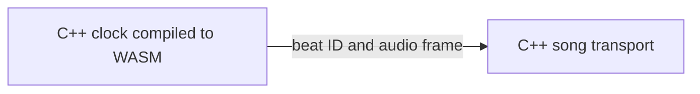
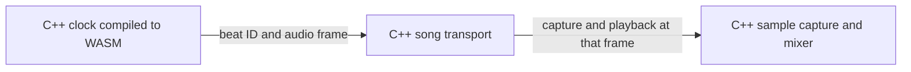
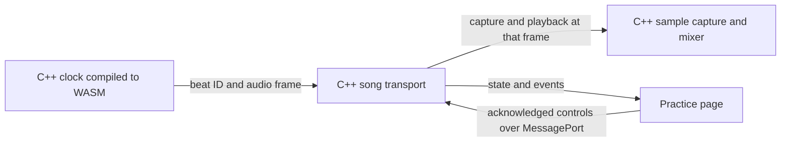

# How the practice instrument fits together

The practice desk is a browser instrument that records your microphone into loops and plays those loops against a song chart. A shared C++ performance engine owns musical time and execution. The browser worklet supplies audio blocks, and the page displays state and submits controls.

This account describes the shared C++ performance engine as of October 25, 2026. The [development guide](development.md) covers starting another session and dividing the next work. The [practice guide](../ui/practice/README.md) covers performing a take.

## Musical time starts with audio frames

A sample frame is one instant in an audio stream. At 48,000 Hz, 48,000 frames represent one second. The C++ clock advances by the number of frames the browser asks it to process. Its beat events carry both a beat ID and a frame timestamp.

The song transport translates those beat IDs into count-in, bar, and beat. A sheet column describes a musical position, but neither Sheets nor the browser's animation timer advances the song.

The default build uses a starting BPM and manual tempo. Microphone input supplies recorded sound. It does not determine tempo in this build. The optional aubio build can follow detected tempo, but the practice UI does not expose that mode.

The C++ performance engine runs inside the audio worklet. Its `pf_process()` call advances the clock and processes the audio block. When a beat falls inside that block, C++ renders up to the crossing, applies the action, then renders the remainder. A queued commit can therefore end a recording and begin its loop at the same boundary.

The worklet receives microphone PCM and produces stereo PCM for the browser's output. The UI receives snapshots and events after audio decisions. It can stall without becoming the source of beat timing.

This is one `AudioWorkletNode`. `PracticeProcessor`, `PerformanceProcessor`, and `BeatProcessor` are classes in its inheritance chain, not separate audio nodes. These classes route browser messages and serialize native state. They do not dispatch musical actions or synthesize clicks in JavaScript.

The main-thread [PracticeAudio adapter](../ui/practice/audio.ts) creates that processor and its local command endpoint. Tracker commands use the node's original port. Practice and sampler commands use a dedicated `MessageChannel`. This local bridge carries controls and observations without a network round trip.

## C++ executes the performance

The [performance engine](../lib/performance/README.md) owns the clock, sampler, and sequencer. Its `pf_process()` entry point advances the clock, finds beat crossings, resolves chart actions, captures input, and renders samples and click audio. The same C++ implementation builds as WASM for browser practice and as a native library.

The [clock C interface](../lib/beat-tracker/include/beat_tracker.h) supplies phase, beat crossings, command ordering, and optional tempo detection. The [sampler C interface](../lib/sampler/include/sample_engine.h) supplies PCM storage, capture, sparse-hit extraction, retained variants, voices, resampling, gain, mute, and mixing. The [sequencer C interface](../lib/sequencer/include/audio_sequence_engine.h) supplies patterns, quantized launches, playback cues, and capture boundaries.

The performance engine adds song count-in, bar and beat, practice ranges, loop wrapping, chart-action resolution, manual-hit loop resumption, automatic variant selection, channel lights, and control deduplication. It also synthesizes the click. `pf_start()` selects manual tempo and applies the supplied BPM itself. A native caller does not need JavaScript to make those decisions or start the clock.

All components link into the same WASM module. The browser's `manual-clock.wasm` filename is retained, but the file now contains the complete performance engine. PCM and musical state stay in its heap.

The TypeScript bridges have narrower jobs:

- [wasm-performance.ts](../lib/performance/wasm-performance.ts) converts a declarative song into native instruction tables, transfers audio blocks, and formats native state and events.
- [wasm-sequencer.ts](../lib/sequencer/wasm-sequencer.ts) maps pattern names and labels to native IDs and reads sequencer state.
- [wasm-sampler.ts](../lib/sampler/wasm-sampler.ts) maps sample and variant names to native IDs and exposes native sample commands and metadata.

The browser worklet calls `pf_process()` for each block. It does not call a JavaScript beat handler to decide which sound plays. The old JavaScript sequencer and TypeScript transport implementations are removed. An old WASM artifact without the performance API fails startup instead of falling back to JavaScript scheduling. `pf_abi_version()` checks the binary against the generated interface constants.

The combined browser module has a fixed 256 MiB heap and cannot grow it during audio processing. Song configuration, pattern definition, capture preparation, and file loading are command-time operations that may allocate. Native block processing, beat dispatch, capture, rendering, triggering, and commit do not allocate or reclaim sample or pattern memory. Active voices keep their old buffer when a replacement take commits. Active and queued patterns likewise retain their copied definition when that pattern ID is redefined.

Native diagnostic queries can expose borrowed PCM views in the WASM heap. These views do not transfer ownership to JavaScript. A later preparation, load, or engine disposal can invalidate them, so they are unsuitable for persistent UI storage.

## A chart supplies actions, and a press performs them

Each song is a loadable module under [songs](../songs/README.md), beside its JSON chart snapshot. `SongScript` supplies a parsed chart, a `Program`, and a practice range. The registry loads the selected module on demand.

The snapshots contain values, explicit column positions, and control-row notes. Notes supply song-specific pad names. The practice page does not read the live spreadsheet's values at runtime. Selecting columns in Sheets does not refresh a snapshot. Chart changes require updating the snapshot and rebuilding.

`compileChartControls` turns cells into typed actions. The TypeScript bridge uploads those actions as copied instruction data while the engine is stopped. When you press a pad, C++ resolves that pad's row in the active column. A future column's cue does not run early because it is visible on screen. A blank cell performs no action.

For example, `rb` pressed during the lead-in queues capture at the first song bar, even with a multi-bar count-in. `cb` commits at the next bar and starts the captured loop automatically. `crb` commits and starts the previous take while beginning the next capture at that boundary. `x` stops immediately, and `xb` queues a stop at the next bar. A second tap is not required to start a committed loop.

Number-only notation describes manual hits. Beats are 1 through 4. The subdivisions `e`, `&`, and `a` divide each beat into sixteenths. In `&a]`, the bracket identifies the phrase end, so the hits are 4& and 4a. A generic tap cue plays one hit per press. Without that press, normal loop playback continues.

Dance Yrself Clean contains a deliberate song-specific exception. Its cowbell uses complete recordings of bar 3 for the double sound and bar 4 for the single sound. The three presses arm bar 3, commit it and arm bar 4, then commit bar 4. Its script reads the cowbell arrangement row and selects the double take where marked, currently bars 8 and 10. You do not need to double-tap those playback marks. Selection changes an already-playing loop and respects an explicit stop.

That exception lives in [dance-yrself-clean.ts](../songs/dance-yrself-clean.ts), not the shared UI. The script produces `barPlayback` data when the song loads. C++ executes that data on the corresponding downbeats. Song scripts do not receive per-beat callbacks. Generic sparse capture still extracts individual attacks near hinted beat positions. DYC's whole-bar cowbell hints bypass extraction because the quiet sounds were not being selected reliably. Those full bars intentionally retain their silence and any other captured sound.

Drunk Girls and I Can Change have timing and section snapshots, but their pad-action rows are blank. Choosing one does not supply a completed arrangement. All current songs start with empty samples.

## The UI observes the instrument

[app.ts](../ui/practice/app.ts) owns browser interaction and presentation. [model.ts](../lib/performance/model.ts) defines the shared controls and state. The pad grid matches keyboard position, with Q/W above A/S. Escape invokes Panic even while a field has focus. Other pad shortcuts avoid fields being edited. The removed foot control is not a record control.

Pad light states come from C++. The UI renders those states. An available unused cue pulses when the loop is inactive. Armed actions, recording, and playing loops glow steadily. A queued stop pulses with diminishing strength until its boundary. Completed stops turn the light off. A redesign can change their appearance while the native engine remains the owner of musical state.

Samples begin at unity gain. Each pad's slider adjusts its channel. Mute preserves the loop's phase. Stop and Panic cancel pending actions, commit active captures, and silence sample output and click. Their browser handlers also cancel startup work and release the microphone, including when a backend command fails.

## A demo download has a separate audio route

There are two kinds of recording. Sample capture records microphone input into a loop. Demo recording records the performance for download.

The worklet output contains rendered samples and the enabled click. That stereo output goes both to speakers and to the demo recording destination. A separate microphone branch downmixes live voice to mono and adds it to both recording channels. That branch does not monitor live voice through speakers. Sample stereo stays unchanged.

This explains the earlier balance fix. Centering belongs on the recording's live-voice branch. Downmixing the entire output would also destroy sample stereo.

**Start practice** requests the microphone and prepares demo recording automatically. The lead-in always clicks, even with song click off. The prepared recorder waits until the UI receives the first `playing` state, excluding the lead-in from the download. Its start is therefore tied to a delivered state update rather than a sample-exact worklet export boundary.

After Stop, native MediaRecorder data is decoded locally and sent to a separate [MP3 worker](../ui/practice/mp3-worker.ts). The worker produces stereo 192 kb/s MP3. The page blocks a replacement take while export finishes. A successful export replaces the prior download. A failed export preserves access to the prior completed file.

Samples and finished downloads live in memory. The service worker caches application assets, not performances. Reloading or disposing the audio session loses captured samples. Download a finished take before leaving the page.

## Sheets following and the relay are separate integrations

The C++ engine queues immutable event records with an increasing sequence number and complete transport and channel state. The queue holds 512 records and counts dropped records. The browser formats them as `PracticeEvent`, adds the run ID, and retains the source sequence number. Beat events retain the source frame and sample rate. `PracticeAudio` adds the sheet IDs and explicit column map. This lets observers follow musical position without estimating it from receipt time.

The current desktop [CDP helper](../scripts/open-chart.md) receives changed columns on loopback port 9223 and controls a Chrome debugging profile on port 9222. Localhost practice follows automatically. Hosted practice opts in through **Open current bar in Sheets**. Delayed requests keep only the newest pending position. Audio does not wait for them. The `show-tools sheets` CLI manages one foreground helper and launches or reuses Chromium on the configured CDP port. Bare startup opens `SHOW_TOOLS_SET_LIST_URL`; a song slug or set-list number opens that song's lead-in. Ctrl+C stops owned processes and leaves reused browsers running.

The helper selects only the requested column through the Name box. It preserves scroll while Sheets performs its automatic reset, then pans once. Previously observed widths keep two preceding columns visible during sequential following. An unfamiliar jump estimates that space. This avoids the old visible sequence of selecting a context column and jumping back to the active one.

The [Chrome extension](../ui/practice/sheets-extension/README.md) is a separate implementation using direct tab events and range fragments. Its complete installed path remains unverified. The helper's live jitter verification does not establish that the extension behaves identically. Neither integration changes chart values.

The [relay](../lib/relay/README.md) is another separate component. It can forward versioned events and simulated controls for a future hardware producer. It stores no audio. Its default port 8082 conflicts with the development static server unless you choose another port. The current practice page does not connect to it, and the native producer does not exist yet.

The intended EliteDesk owns audio processing and hardware controls. Other devices host the UI. Events may cross a lightweight server later, while audio timing stays with the audio host. For today's mobile practice, an HTTPS static host is sufficient.

## The next features cross different boundaries

The approved effects design processes live mono microphone into stereo through the default or capture-target voice stack, then caches that processed result for sampled playback. Cached audio must not pass through its baked stack again. Logical voice IDs are separate from button IDs. Per-effect venue tuning belongs in the web UI. Eligible monitors and room outputs receive processed live audio when input/output are different physical devices or the same confirmed USB interface. Downloads remain processed independently of that monitoring decision.

The standalone [patches module](../lib/patches/README.md) begins this work with generic full-output C++ effects and a processed-cache release prototype. Its synthetic live render produces both output and exact cached stereo PCM. Playback reads that PCM while an auxiliary rack consumes retained source silently to maintain release state. Natural stop tails come from zero-input continuation of that auxiliary state, never from processing cached output again. Restore capture-start state only when a new loop iteration actually starts. This preserves the recorded phase's tail, rather than claiming the same feedback history as an endlessly processed source loop.

This module is not yet connected to `pf_process()`, sampler capture, browser stems, or venue controls. The current practice route still captures raw mono input and adds the separate recording-only microphone branch described above. Those routes change together in a coordinated performance ABI milestone. Native capture preparation also needs an audit before callback application because current arm controls reach allocating `st_prepare()` calls. Standalone DSP verification does not prove the browser feature or native host callback safe.

EliteDesk work can use the complete native performance library, including song transport, sequencing, sampling, and click rendering. Its manual-tempo CMake target excludes aubio and libsndfile. The separate tracker executable still processes WAV files rather than live devices. A live audio host, a loader for compiled song instructions, physical control drivers, and a hardware event producer remain to be built. That work connects the shared engine to the machine; it does not require another port of the musical logic.

The native processing path uses prepared buffers and fixed queues. Configuration, preparation, and loading can allocate outside that path. JavaScript state serialization still allocates objects and arrays, so the whole browser worklet is not allocation-free. A live native host needs its own realtime audit. Browser correctness tests do not prove hardware audio latency or absence of underruns.

## Why these boundaries exist

The user requested local practice without a deployed relay, UI code under `ui/`, song behavior outside the UI, and an EliteDesk focused on audio. Those instructions establish the architecture's intended direction. The implementation and corrective commits establish the current behavior.

The local WASM clock keeps practice usable on a static host. Song modules keep DYC-specific rules out of generic controls. Deterministic Sheets code makes following repeatable without an LLM in the loop. Centered voice and MP3 export make the recorded demo useful outside the app. The user clarified that the complete musical engine belongs in C++ for both WASM and native execution. That ownership now includes transport, sequencing, chart actions, sampling, mixing, and click generation. TypeScript retains browser adaptation, declarative song loading, and protocol metadata.

The default manual WASM clock excludes aubio. The optional full WASM build and existing native tracker build link GPL-3.0-or-later aubio. The standalone native performance, sequencer, and sampler targets do not use aubio. Effect is MIT-licensed. MP3 export uses an MIT wrapper around LGPL-2.0-or-later LAME. The [MP3 notice](../ui/practice/licenses/README.md) records that copyleft exception.

The rationale above uses this session's explicit requirements, repository code, and commit history. It does not claim an external design review or hardware measurement. Useful changes to inspect with `git show` are `0b34710` for the practice architecture, `75f3afb` for cowbell variants, `91e45b7` for voice centering, `7eb9e09` for Sheets jitter, `fea846a` for lead-in exclusion, and `86fd6ec` for MP3 export.

## Video studies consume explicit time

The independent [Gator and Tapir studio](../ui/video/README.md) lives under `ui/video/`. One PixiJS renderer displays eight character treatments from `assets/video/`. A small C++ utility under `lib/video/` samples held poses and restrained upper-body movement from a supplied quarter-note position; it compiles natively and to its own WASM module. It owns no timer, musical control, or transport.

The studio currently runs an explicit four-second preview score. Its validated in-process performance adapter can accept authoritative PE observations, but a live subscription is not connected. Rendering never advances PE time or replays audio commands. `npm run build:video` is independent of the practice build and leaves the practice offline cache unchanged. The practice desk remains the supported audio UI. Actual CRT conversion and audiovisual synchronization remain separate verification tasks.

## Peripheral wiring diagnostics are separate from musical control

[lib/peripherals](../lib/peripherals/README.md) supplies a native operator-run I-PAC probe, capture summaries, and a portable C++ input latch and explicit light math. The Mac and Linux host adapters report actual keyboard and relative-axis input. A guarded single-LED command requires an explicit operator invocation, observed compatible output descriptor, selected channel, and wiring confirmation. Tests open no devices.

These tools do not configure firmware or song bindings. Performance Engine still owns musical resolution, applied frames, tempo, and semantic light feedback. Device adapters own actual IO and consumer cadence. The current PF compatibility fixture does not establish the new 6/8 or relative-control contracts, and production browser pad integration remains coordinated work. Local WASM practice remains independent of peripherals and the relay.
