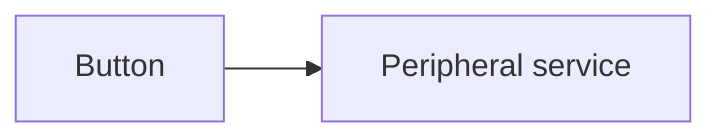
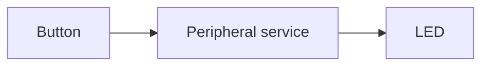
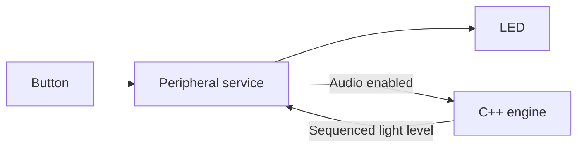

# Start an EliteDesk practice session

Use this procedure on the EliteDesk as `anulman`. It covers Dance Yrself Clean, Drunk Girls, and Tribulations with two through six physical buttons and the dial.

The web service keeps the desk available. The peripheral service reads the I-PAC and lights held buttons, including when audio is off. **Enable audio** prepares the sampler. **Start practice** starts the count-in and song. These are separate actions.

## Find the installed commands

Open a terminal on the EliteDesk. Run the following block in that terminal:

```sh
PRACTICE_PROFILE=/home/anulman/.config/show-tools/session.json
PERIPHERAL_PROFILE=/home/anulman/.config/show-tools/peripheral.json
PRACTICE_RELEASE=$(python3 - "$PRACTICE_PROFILE" <<'PY'
import json, pathlib, sys
p = json.loads(pathlib.Path(sys.argv[1]).read_text())
if p.get('schemaVersion') != 2:
    raise SystemExit('This profile needs the reviewed V2 deployment. Stop here.')
node = pathlib.Path(p['server']['nodeExecutable'])
root = node.parent.parent
if node != root / 'runtime/node' or pathlib.Path(p['server']['entrypoint']) != root / 'gateway/server.mjs':
    raise SystemExit('Profile does not identify a packaged release. Stop here.')
for name in ('bin/show-tools-session', 'bin/show-tools-peripheral', 'native/peripheral/peripheral-host'):
    if not (root / name).is_file():
        raise SystemExit('Installed command missing: ' + name)
print(root)
PY
) && export PRACTICE_PROFILE PERIPHERAL_PROFILE PRACTICE_RELEASE

practice() { test -n "$PRACTICE_RELEASE" || return 1; "$PRACTICE_RELEASE/bin/show-tools-session" "$@" --profile "$PRACTICE_PROFILE"; }
hardware() { test -n "$PRACTICE_RELEASE" || return 1; "$PRACTICE_RELEASE/bin/show-tools-peripheral" setup \
    --config "$PERIPHERAL_PROFILE" --session-profile "$PRACTICE_PROFILE" \
    --helper "$PRACTICE_RELEASE/native/peripheral/peripheral-host" \
    --bench-dir "$PRACTICE_RELEASE/bench" \
    --runner "$PRACTICE_RELEASE/bin/show-tools-peripheral" "$@"; }
```

If discovery reports an error, stop here. The commands below require the matched V2 release and its installed user services. An older global `show-tools` command does not identify this release.

## Install the peripheral service once

Skip this step after the peripheral service has been installed. Its initial installation must run locally as `anulman`, without `sudo`. The existing remote web-deployment grant does not enable this separate service.

The deployment supplies a reviewed installation packet for the exact installed release. Run:

```sh
PRACTICE_BOOTSTRAP=$(python3 - "$PRACTICE_RELEASE/release.json" <<'PY'
import json, pathlib, re, sys
p = json.loads(pathlib.Path(sys.argv[1]).read_text())
r = p.get('sourceRevision', '')
if p.get('schemaVersion') != 2 or not re.fullmatch('[0-9a-f]{40}', r):
    raise SystemExit('A reviewed V2 release is required.')
print('/home/anulman/.local/share/show-tools/staging/peripheral-service-' + r[:7] + '-' + r[:7])
PY
) && /bin/sh "$PRACTICE_BOOTSTRAP/OPERATOR-COMMAND.txt"
```

The command verifies the pinned installer and packet, then installs, enables, and starts only `show-tools-peripheral.service`. It writes no input map and opens no USB or audio device. The service waits for the capture step below. If the packet is missing, deployment is incomplete. If a peripheral profile already exists, preserve it and skip this initial-install path.

## Check the services before touching the controls

```sh
practice start
practice status
systemctl --user start show-tools-peripheral.service
hardware --status
practice songs list
```

Expect the web server to be active and the song list to contain `dance-yrself-clean`, `drunk-girls`, and `tribulations`. On a fresh server, audio is off. `practice start` preserves an existing performance.

An unconfigured peripheral service can be active while it waits for an input map. Its journal says that USB is unopened. Continue with capture below.

`practice status` also reports `Linger`. `Linger=yes` permits the user services to survive the last logout. `Linger=no` requires host provisioning before relying on unattended operation.

## Capture the connected buttons

If a song is running, click **Stop** first. Terminating audio discards all recorded takes. To configure hardware, turn audio off:

```sh
practice audio off
hardware --start --stop-performance
```

Follow the foreground prompts:

1. Enter the connected identities, separated by commas. With the current two buttons, enter `blue,yellow`. The full set is `blue,yellow,red,green,pedal,mushroom`.
2. Release every control. Press Enter for the named button.
3. Wait for `ARMED`. Press and fully release that button three times. Leave it released.
4. Repeat for each named button.
5. Enter each button's actual LED output number, or `none` for a button without an LED. The confirmed current wiring is Blue on output `1` and Yellow on output `2`.
6. Confirm the listed wiring only after checking the actual connections and polarity.

The setup tool captures actual input codes. It does not derive codes from header labels such as `2SW7`. `--stop-performance` explicitly authorizes stopping the web service and discarding any remaining takes. The tool verifies that its owned processes have exited before capture. This also prevents a browser from enabling audio during the save.

Setup stops the named peripheral service, saves the complete validated map, and starts it after a successful save. It restores a previously active web service after cleanup. On cancellation or failure, read the diagnostic before restarting services. Wait for the terminal to report completion before starting another command.

To add buttons later, rerun `hardware --start --stop-performance` and include every connected identity you want to retain. Two buttons are enough to complete setup. Do not enter six until six separate identities are connected.

## Check the LEDs with audio off

```sh
hardware --test
```

Hold each named button, then release it. Confirm `yes` only if the corresponding LED reaches full brightness while held and returns to its prior level on release. With audio off, the prior level is off.

The test asks you to observe real LEDs. A successful capture or active service does not prove that an LED is electrically connected.

## Capture and test the dial

Keep audio off. Run:

```sh
hardware --dial --stop-performance --direction clockwise --capture-seconds 5 \
    --jiggle-travel 4 --jiggle-reversal 2
```

Wait for `ARMED`, then turn the dial clockwise during the capture window. Leave the buttons released. If more than one axis moves, choose the listed axis that belongs to the dial. The tool saves the observed relative-Y source and keeps the button and LED map.

The `4` travel and `2` reversal thresholds are initial trial values in raw counts. They are not a calibration result. Repeat this command with different explicit values if small accidental movements activate the effect or deliberate jiggles fail to activate it. Use `--disable-jiggle` instead of both threshold flags to capture the dial with musical jiggle forwarding disabled.

```sh
systemctl --user start show-tools-peripheral.service
hardware --status
```

Expect `Dial: configured`. Direction here labels your capture motion. The tool does not infer degrees, counts per revolution, or an effect assignment.

## Assign buttons to each song

Open [the EliteDesk practice desk](https://proxmox.tail54fc55.ts.net:8443/ui/practice/?remote) on your laptop or phone. Keep **Hardware mode (EliteDesk)** selected. If requested, use **Enter key** with the existing private session key. The browser can remember the key on that origin. Do not paste the key into a URL or this document.

For each song:

1. Keep audio off. Select the song at the top of the desk.
2. Open **Button assignments**.
3. Choose **Cue rows** for each connected button you want to use.
4. Check the required `R1`, `R2`, `L1`, or `L2` rows for that button.
5. Leave unused identities **Unassigned**. Use **Tempo tap** or **Panic** only when you want that function on that button.
6. Click **Apply button assignments**. Wait for **Assignments saved.**

A button can perform several cue rows on one press. Each row can belong to only one physical button. Group rows only when you intend to perform their eligible cues together. With two buttons, choose your grouping explicitly. With more buttons, assign the rows separately as desired.

Assignments belong to the selected song and persist in SQLite. Repeat the assignment step for all three songs. Audio must be off to change songs or assignments. Reload the page and select each song again to check the saved choices.

## Test one capture before playing the whole song

Start with Dance Yrself Clean:

1. Select the song with audio off. Check its saved button assignments and practice range.
2. Click **Enable audio**. Wait for the ready state. This does not start transport.
3. Set a low output level. Ready audio with stopped transport is silent.
4. Click **Start practice**. During the count-in, check the click and processed microphone sound. Perform the first written recording cue with its assigned physical button. If routing or levels are wrong, click **Stop** before continuing.
5. Check that the recording button pulses with the beat. Hold it briefly to check that full brightness overrides the pulse.
6. Release it. Check that the recording pulse resumes. After commit, check playback. The LED becomes steady when its assigned rows are playing and none are recording; a continuing recording keeps the pulse.
7. Click **Stop**. Check that the takes remain available.

If the short test passes, start the full practice range. Then repeat the short test and full practice for Drunk Girls and Tribulations. To change songs, use **Terminate audio**, select the next song, and enable audio again. Terminate discards the previous song's in-memory takes.

For Drunk Girls, check the eight-bar pickup loop before the later sustained-sample passages. For Tribulations, check replacement guitar layers and the prepared tambourine sample. Musical cues come from the canonical chart. A missed play or stop remains missed. Only authored commit operations auto-complete.

To use Tribulations' phone tambourine, open the same hardware desk on the phone, select **Enable shake** for its displayed voice, and grant motion permission. Test during that voice's written playing window. Stop disables shake input; enable it again before the next run. Phone motion and audible playback require a physical check on that phone.

During a song, any configured button with an LED still reaches full brightness while held, including an unassigned musical button. Release restores the sequenced level. Recording pulses take priority over the playing level, which is at most 70%.

## Stop and start without an agent

These commands act on the existing installed services. Use the same terminal definitions from the first step.

```sh
# Inspect without changing audio or transport.
practice status
practice audio status
hardware --status

# Enable stopped audio, or terminate it and discard takes.
practice audio on
practice audio off

# Stop or start the web server. Stopping also discards native takes.
practice stop
practice start

# Stop or start hardware capture and physical LED feedback.
systemctl --user stop show-tools-peripheral.service
systemctl --user start show-tools-peripheral.service

# Read recent diagnostics.
journalctl --user -u show-tools-web.service -n 80 --no-pager
journalctl --user -u show-tools-peripheral.service -n 80 --no-pager
```

Use the desk's **Stop** button to stop transport while retaining takes. The CLI's `stop` command stops the web service and discards takes. Stopping the peripheral service also stops idle button feedback.

To stop both services for the night:

```sh
systemctl --user stop show-tools-peripheral.service
practice stop
```

## Back up the song assignments

Choose a new backup filename:

```sh
practice bindings backup --output /home/anulman/practice-bindings-backup.sqlite
"$PRACTICE_RELEASE/bin/show-tools-session" bindings verify \
    --input /home/anulman/practice-bindings-backup.sqlite
```

This backup contains per-song button bindings and chart source hashes. It excludes MusicXML charts, effects, character assignments, and recordings. Restore creates a new database file and does not change the running profile:

```sh
"$PRACTICE_RELEASE/bin/show-tools-session" bindings restore \
    --input /home/anulman/practice-bindings-backup.sqlite \
    --output /home/anulman/practice-bindings-restored.sqlite
```

## Resolve a failed check

| What you see | What to do |
| --- | --- |
| V2 profile or installed command is missing | Complete the matched release deployment. Do not substitute the old global CLI. |
| `songs list` lacks a practice song | Check the deployed catalog. Do not substitute an unapproved effects file to make a package load. |
| Setup rejects the service unit | Install the reviewed unit for this release and profile. Do not run a second USB reader. |
| Setup was cancelled and the web service is stopped | Run `practice start`, then inspect `hardware --status`. Rerun capture if no configuration was saved. |
| Capture reports no complete pairs | Release every button. Rerun capture and wait for `ARMED` before pressing the named button three times. |
| Two buttons produce the same identity | Capture and configure distinct board key assignments before mapping them to different song actions. |
| Capture works, but an LED stays dark | Check the saved output association, LED supply, wiring, and peripheral journal. Do not infer an enable-mask or firmware change. |
| A held LED works, but no cue runs | Check audio readiness, the selected song's saved row assignments, and the current chart cell. Idle presses are not replayed when audio starts. |
| A button stays at full brightness after release | Stop the peripheral service. Check for a missing release or device error before restarting it. |
| Song selection or assignments are disabled | Stop transport, then terminate audio. Wait for audio off. |
| Audio fails to enable | Read the web journal. Check the configured interface and its direct-monitor setting. Do not choose a floating default device. |
| The browser disconnects | Reconnect to the same desk. A disconnected browser does not stop native audio. Check status before starting or restarting anything. |

Physical readiness requires observed button pairs, visible held and released LEDs, dial capture, microphone capture, and audible playback on the EliteDesk. Synthetic tests alone do not establish those results.

## How a press reaches the instrument

The peripheral service reads the physical button:



That service also owns held-button lighting. This path works with audio off:



When audio is enabled, the service also forwards the press to the C++ engine. The engine decides which chart cues are eligible and supplies the recording or playback light level:



The held press overrides that level at full brightness. Release reveals the engine's current level again. The web page sends controls and displays state; closing the page does not stop the native performance.
